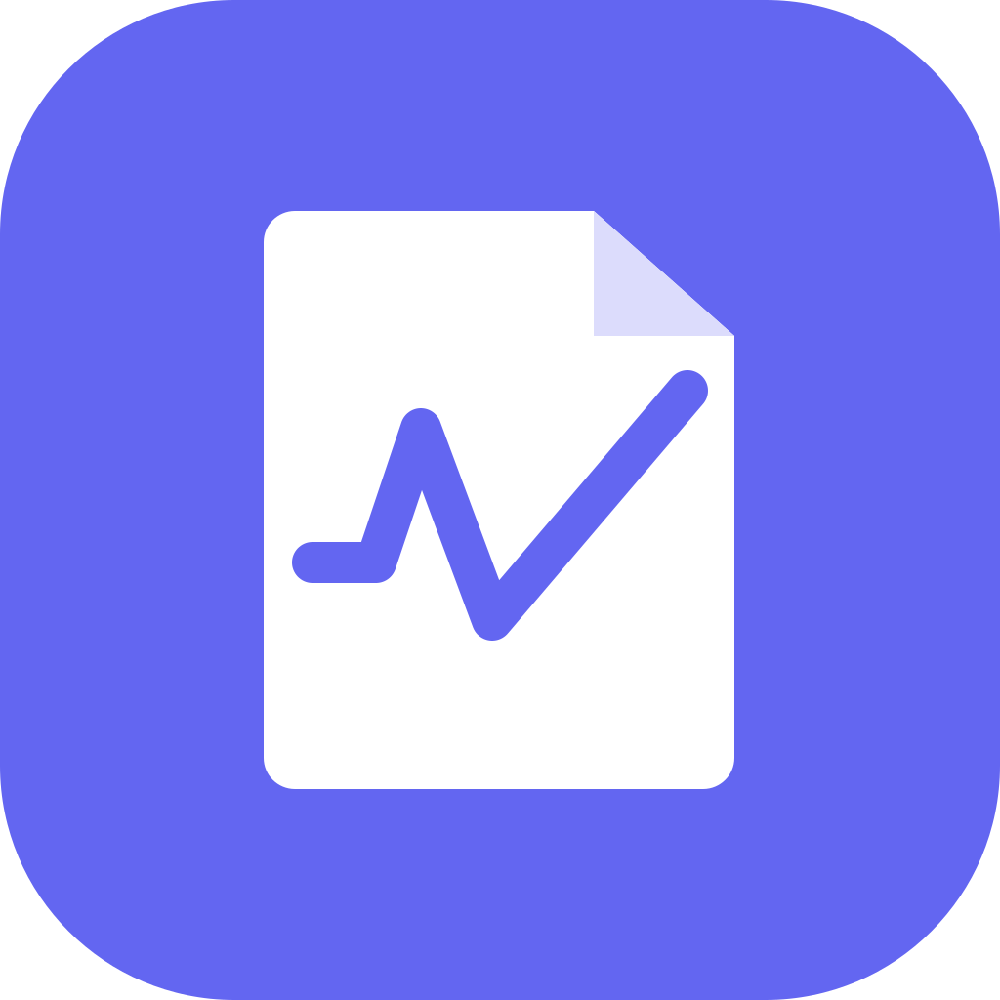
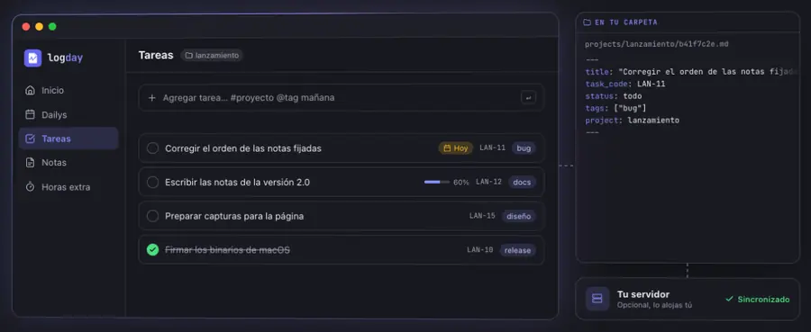
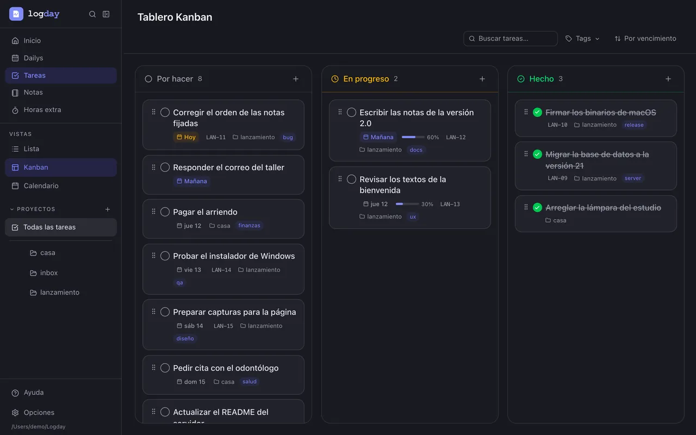
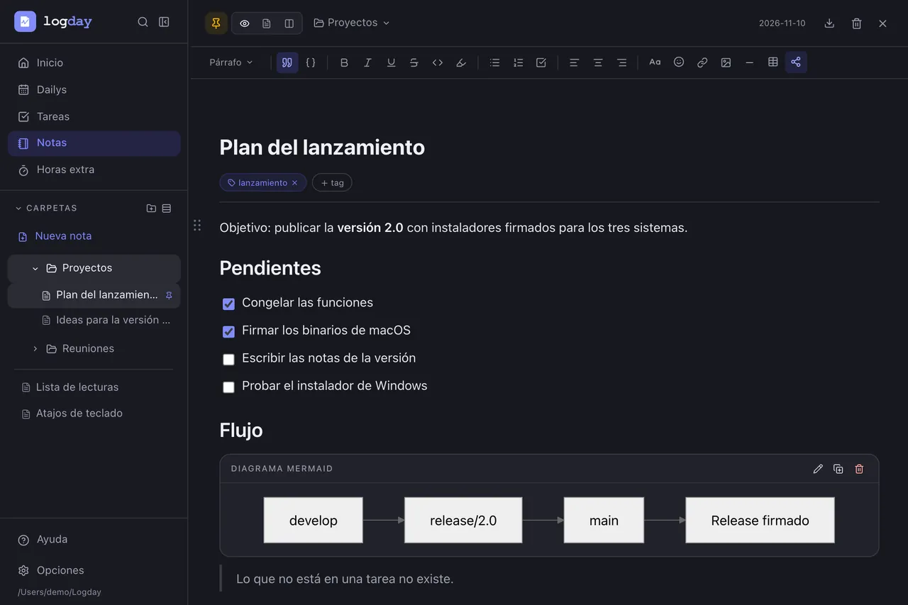
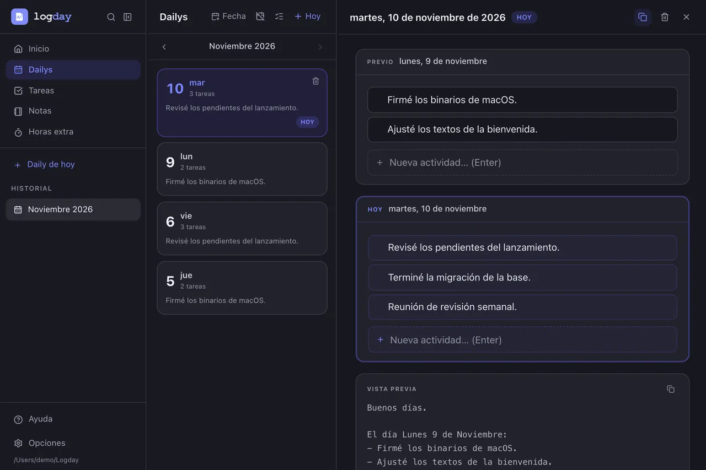
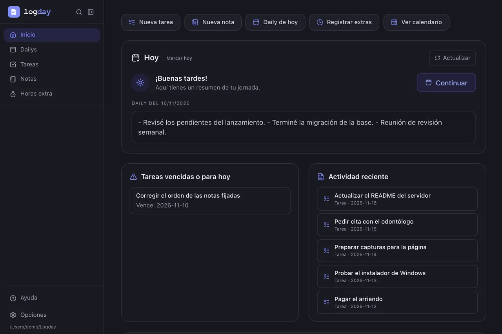

<p align="center">
  <a href="https://logday.dev"></a>
</p>

<h1 align="center">Logday</h1>

<p align="center">
  <strong>Tu día de trabajo, en archivos que son tuyos.</strong><br>
  Tareas, notas, dailys y horas extra en Markdown, en una carpeta que eliges tú.<br>
  Funciona sin conexión y, si quieres, se sincroniza con tu propio servidor.
</p>

<p align="center">
  <a href="https://github.com/jorgebuitragor/logday/releases/latest"></a>
  
  <a href="./LICENSE"></a>
</p>

<p align="center">
  <a href="https://logday.dev"><strong>logday.dev</strong></a> ·
  <a href="#descargar">Descargar</a> ·
  <a href="#qué-incluye">Funciones</a> ·
  <a href="#el-ecosistema">Ecosistema</a> ·
  <a href="README.md">English</a>
</p>

<p align="center">
  <a href="https://logday.dev"><picture><source media="(prefers-color-scheme: light)" srcset="docs/readme/un-dia-en-logday-claro.webp"></picture></a>
</p>

Este repositorio es **Logday Desktop**, la app de escritorio, y la puerta de entrada al proyecto. La presentación completa está en **[logday.dev](https://logday.dev)** ([en inglés](https://logday.dev/en/)).

## Descargar

**[Descargar la última versión](https://github.com/jorgebuitragor/logday/releases/latest)**, o entra a [logday.dev](https://logday.dev/#descargar), que reconoce tu sistema y te da el archivo correcto.

<!-- Enlaces de la versión actual. Se actualizan en cada release (AGENTS.md, "Releases"). -->
| Sistema | Requisitos | Descarga directa (v1.3.0) |
|---|---|---|
| macOS | Mac con Apple Silicon (M1 o posterior) | [`.dmg`](https://github.com/jorgebuitragor/logday/releases/download/v1.3.0/Logday_1.3.0_aarch64.dmg) |
| Windows | Windows 10 u 11, de 64 bits | [Instalador `.exe`](https://github.com/jorgebuitragor/logday/releases/download/v1.3.0/Logday_1.3.0_x64-setup.exe) · [`.msi`](https://github.com/jorgebuitragor/logday/releases/download/v1.3.0/Logday_1.3.0_x64_en-US.msi) |
| Linux | x86_64 | [`.AppImage`](https://github.com/jorgebuitragor/logday/releases/download/v1.3.0/Logday_1.3.0_amd64.AppImage) · [`.deb`](https://github.com/jorgebuitragor/logday/releases/download/v1.3.0/Logday_1.3.0_amd64.deb) · [`.rpm`](https://github.com/jorgebuitragor/logday/releases/download/v1.3.0/Logday-1.3.0-1.x86_64.rpm) |

La app avisa cuando sale una versión nueva y se actualiza sola, así que da igual si descargas una versión anterior. Las notas de cada versión están en [Releases](https://github.com/jorgebuitragor/logday/releases).

**La primera vez que la abres:**

- **macOS:** la app está firmada pero no notarizada por Apple, así que macOS no la deja abrir la primera vez. Ve a Ajustes del Sistema → Privacidad y seguridad y pulsa **Abrir igualmente**.
- **Windows:** si SmartScreen muestra "Windows protegió su PC", pulsa **Más información** → **Ejecutar de todas formas**.
- **Linux:** al `.AppImage` hay que darle permiso de ejecución (`chmod +x Logday_*.AppImage`).

## Qué es Logday

- **Tus archivos.** Cada tarea, nota y daily es un archivo de texto (Markdown y JSON) en una carpeta que eliges tú. Puedes abrirlos con cualquier editor, versionarlos con Git o respaldarlos como quieras.
- **Sin conexión.** La app funciona completa sin internet y sin cuenta.
- **Tu servidor, si lo quieres.** No hay un Logday en la nube: el sync es con un servidor que alojas tú o tu organización.
- **Hecho para el trabajo diario.** Además de tareas y notas, anota lo que hiciste cada día, arma el mensaje para la reunión diaria y calcula las horas extra.
- **Software libre**, con licencia [AGPL-3.0](./LICENSE).

<table>
  <tr>
    <td width="50%"><picture><source media="(prefers-color-scheme: light)" srcset="docs/readme/kanban-claro.webp"></picture><p align="center"><b>Tareas</b>: lista, Kanban y calendario</p></td>
    <td width="50%"><picture><source media="(prefers-color-scheme: light)" srcset="docs/readme/notas-claro.webp"></picture><p align="center"><b>Notas</b>: editor enriquecido, guardado en Markdown</p></td>
  </tr>
  <tr>
    <td width="50%"><picture><source media="(prefers-color-scheme: light)" srcset="docs/readme/dailys-claro.webp"></picture><p align="center"><b>Dailys</b>: el mensaje para tu equipo, listo</p></td>
    <td width="50%"><picture><source media="(prefers-color-scheme: light)" srcset="docs/readme/inicio-claro.webp"></picture><p align="center"><b>Inicio</b>: el día de un vistazo</p></td>
  </tr>
</table>

La animación y las capturas usan datos de demostración, y se ven en el tema de tu GitHub (claro u oscuro).

## El ecosistema

Logday son cuatro piezas que comparten el mismo modelo de datos y el mismo protocolo de sync. Puedes usar solo Desktop o todas juntas.

| Pieza | Qué es | Estado |
|---|---|---|
| **Logday Desktop** (este repo) | La app más completa, para macOS, Windows y Linux. Hecha con Tauri. | [Disponible](#descargar) |
| Logday Web | Tus datos desde el navegador. La sirve tu propio servidor, en `/app`. | Incluida en el servidor |
| [Logday Mobile](https://github.com/jorgebuitragor/logday-mobile) | Android e iOS, con el mismo sync. | En desarrollo |
| [logday-server](https://github.com/jorgebuitragor/logday-server) | El servidor de sync que alojas tú: un binario en Go, multiusuario, con panel de administración. | [Imagen Docker](https://github.com/jorgebuitragor/logday-server#readme) |

Para tener tu propio servidor basta un contenedor:

```bash
docker run -d --name logday -p 8080:8080 \
  -e JWT_SECRET="$(openssl rand -base64 32)" \
  -e DATABASE_PATH=/data/logday.db \
  -v logday-data:/data \
  ghcr.io/jorgebuitragor/logday-server:latest
```

En producción va detrás de HTTPS. El paso a paso está en el [README del servidor](https://github.com/jorgebuitragor/logday-server#readme).

## Qué incluye

- **Inicio:** resumen del día con la semana en miniatura. Puedes elegir qué pantalla abre la app al arrancar.
- **Tareas:** proyectos y subproyectos; estados por hacer, en curso y hecha; vistas de lista, Kanban y calendario. También vencimiento, tags, rutas vinculadas, progreso opcional (0–100) y contenido en Markdown. La entrada rápida entiende `#proyecto`, `@tag` y fechas como "mañana".
- **Notas:** carpetas y subcarpetas, editor enriquecido (TipTap) con Markdown, diagramas Mermaid con editor visual y vista previa de enlaces. Se pueden fijar, duplicar, mover y exportar a MD, TXT o PDF.
- **Dailys:** un registro por día, agrupado por mes, con historial.
- **Calendario y ausencias:** eventos propios y días de ausencia, con los festivos de Colombia.
- **Horas extra:** registro por mes, cálculo de las franjas de extras y exportación a Excel.
- **Papelera:** lo que borras se puede restaurar. La purga automática es opcional.
- **Búsqueda global**, atajos configurables, confirmación antes de borrar e idiomas español e inglés.
- **Temas:** sistema, claro, oscuro, alto contraste, descanso visual, sepia, OLED y nórdico, además de temas personalizados.
- **Bandeja del sistema:** al cerrar la ventana, la app sigue en la bandeja. Desde ahí se abre la app, se crea una nota o una tarea y se abre la captura rápida.
- **Respaldo:** exporta todo a un ZIP e impórtalo después. También hay integración opcional con Git para versionar la carpeta de datos (commit, push, pull desde la app).
- **Actualizaciones automáticas:** la app avisa cuando hay versión nueva y muestra sus novedades.

### Sync con logday-server (opcional)

En Opciones → Sync conectas la app a tu propio servidor. Ahí también ves y cierras las sesiones de tus otros dispositivos. Cada campo se resuelve por separado (gana el último que escribió), y el texto de las notas y los dailys se fusiona con CRDT (Yjs). Así dos dispositivos pueden editar lo mismo sin pisarse. La primera vez, la app sube los datos que ya tenías.

### Extensiones

Vienen incluidas y apagadas. Se activan en Opciones → Extensiones, y las que tienen vista propia aparecen en el menú lateral.

| Extensión | Qué hace |
|---|---|
| Chat del equipo | Envía tu daily al chat de tu equipo (Google Chat, Slack o Microsoft Teams). |
| Agentes de IA (MCP) | Deja que Claude Code, Codex u otro agente con MCP lea tus tareas, dailys, notas y horas extra y, si lo permites, cree tareas y notas. |
| Google Calendar | Muestra tus reuniones en el Calendario de Logday, en solo lectura. |
| Webhook saliente (n8n) | Avisa a n8n u otro servicio cuando creas o completas una tarea, guardas horas extra o envías tu daily. |
| Granola | Trae tus reuniones de Granola como notas. |
| OpenProject | Trae como tareas los work packages que tienes asignados o de los que eres responsable. |
| Excalidraw | Dibujos y diagramas a mano dentro de las notas. |
| Captura rápida | Un atajo de teclado global abre una ventanita encima de cualquier app para anotar una tarea o una nota. |

Los secretos de las extensiones (tokens, URLs de webhooks) se guardan en el llavero del sistema, no en la configuración.

## Dónde quedan los datos

La app trabaja sobre la carpeta base que eliges al empezar:

```text
<carpeta base>/
  projects/<proyecto>/<id>.md     una tarea por archivo
  notes/                          notas (.md) y su estado CRDT (.ydoc)
  dailys/<año>/<mes>/             dailys del mes
  overtime/<año>/<mes>/           horas extra del mes
  calendar/                       eventos del calendario
  absences.json                   días de ausencia
  .trash/                         papelera
```

La configuración de la app (`config.json`, con la carpeta base y las preferencias) vive en el directorio de datos de Tauri. Las preferencias de interfaz son de cada equipo y no se sincronizan.

## Desarrollo

Está hecha con Tauri 2 + React 19 + TypeScript.

Requisitos:

- Node.js 20.19 o superior.
- pnpm (la versión está en `packageManager` de `package.json`).
- Rust estable.
- En Linux, además, las dependencias de sistema de Tauri.

```bash
pnpm install
pnpm tauri dev     # la app completa (frontend + Rust)
pnpm test          # vitest (zona horaria fija en America/Bogota)
pnpm lint
pnpm build         # tsc + vite
cargo check --manifest-path src-tauri/Cargo.toml
```

Instaladores locales: `pnpm tauri build`. Los releases oficiales salen de `.github/workflows/release.yml` al subir un tag `vX.Y.Z`. El flujo completo está en [`AGENTS.md`](./AGENTS.md#releases).

### Problemas comunes

- **El puerto 1420 está ocupado** (Vite no arranca): cierra la otra sesión de `pnpm tauri dev`, o libera el puerto con
  `lsof -nP -iTCP:1420 -sTCP:LISTEN | awk 'NR>1 {print $2}' | xargs -r kill`.
- **La app se reinicia dos veces en desarrollo:** hay más de una sesión de `pnpm tauri dev` abierta. Deja solo una.
- **`pnpm lint` falla con `util.styleText`:** la versión de Node es anterior a 20.19.

## Documentación

- [`specs/`](./specs/README.md): una carpeta por feature con requisitos, diseño y tareas (Spec-Driven Development). Su índice dice el estado de cada una.
- [`AGENTS.md`](./AGENTS.md): comandos, trampas conocidas, cómo probar sin tocar tus datos reales y cómo se hace un release. Sirve para personas y para agentes de IA.
- El contrato de sync es el de `logday-server` ([`openapi.yaml`](https://github.com/jorgebuitragor/logday-server/blob/develop/openapi.yaml)).

Ramas: Gitflow. El trabajo va en `feature/<slug>` desde `develop`, con PR a `develop`; `main` solo recibe releases.

## Licencia

[AGPL-3.0-or-later](./LICENSE). Software libre: cualquier persona u organización puede usarlo, modificarlo y auto-hospedar su propia instancia. Si ofreces una versión modificada como servicio a terceros, el AGPL exige publicar también ese código modificado (copyleft de red). El texto completo de la licencia tiene el detalle.
