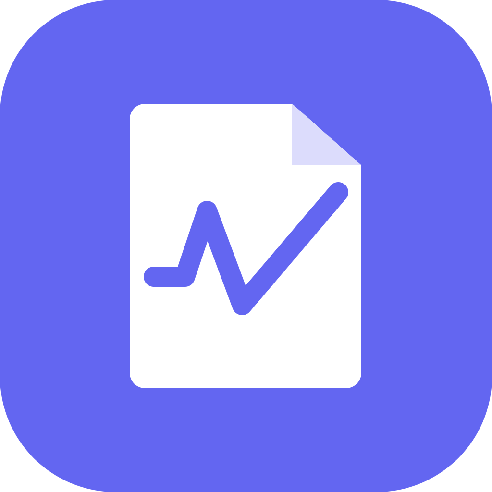
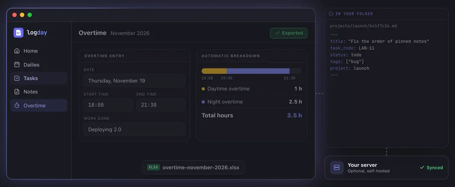
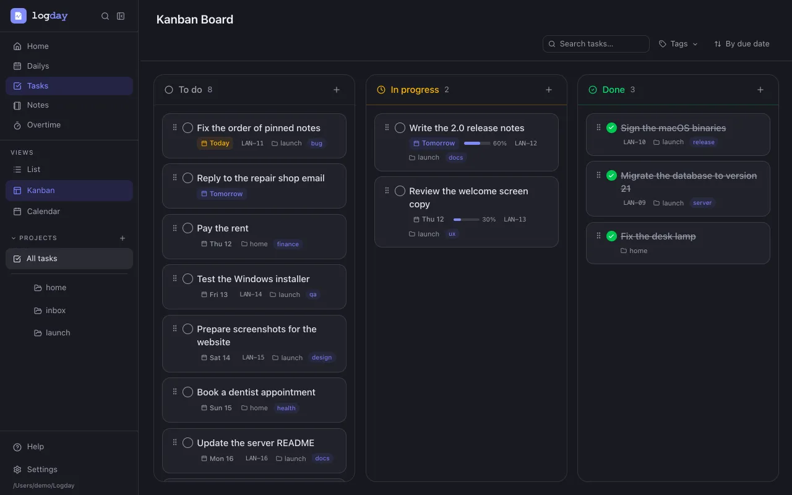
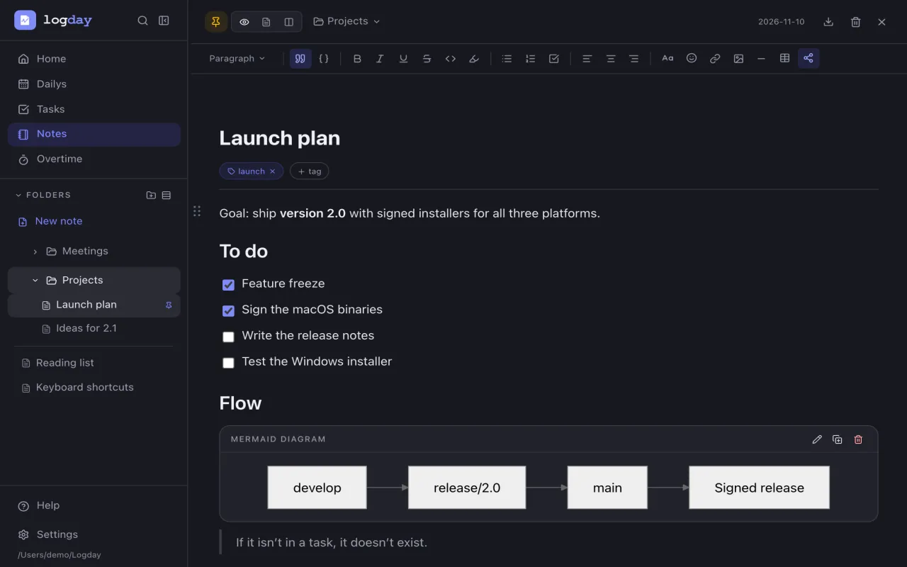
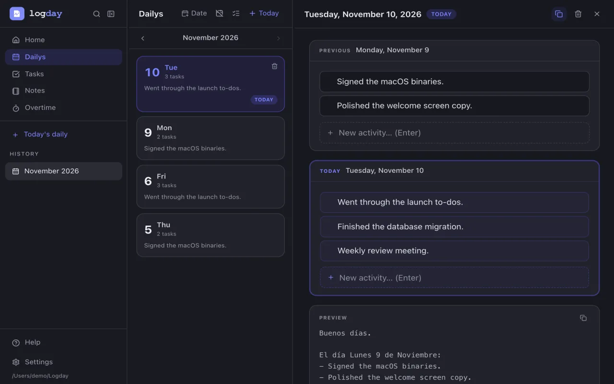
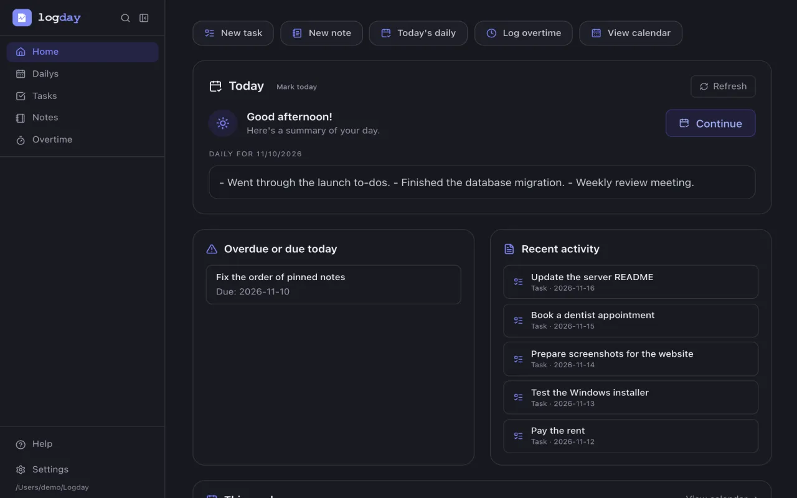

<p align="center">
  <a href="https://logday.dev/en/"></a>
</p>

<h1 align="center">Logday</h1>

<p align="center">
  <strong>Your workday, in files you own.</strong><br>
  Tasks, notes, dailies and overtime as Markdown, in a folder you choose.<br>
  Works offline and, if you want, syncs with your own server.
</p>

<p align="center">
  <a href="https://github.com/jorgebuitragor/logday/releases/latest"></a>
  
  <a href="./LICENSE"></a>
</p>

<p align="center">
  <a href="https://logday.dev/en/"><strong>logday.dev</strong></a> ·
  <a href="#download">Download</a> ·
  <a href="#features">Features</a> ·
  <a href="#the-ecosystem">Ecosystem</a> ·
  <a href="README.es.md">Español</a>
</p>

<p align="center">
  <a href="https://logday.dev/en/"><picture><source media="(prefers-color-scheme: light)" srcset="docs/readme/un-dia-en-logday-claro-en.webp"></picture></a>
</p>

This repository is **Logday Desktop**, the desktop app, and the entry point to the project. The full overview lives at **[logday.dev](https://logday.dev/en/)**.

## Download

**[Download the latest release](https://github.com/jorgebuitragor/logday/releases/latest)**, or go to [logday.dev](https://logday.dev/en/#download), which detects your system and gives you the right file.

<!-- Links for the current version. Updated on every release (AGENTS.md, "Releases"). -->
| System | Requirements | Direct download (v1.3.0) |
|---|---|---|
| macOS | Apple Silicon Mac (M1 or later) | [`.dmg`](https://github.com/jorgebuitragor/logday/releases/download/v1.3.0/Logday_1.3.0_aarch64.dmg) |
| Windows | Windows 10 or 11, 64-bit | [`.exe` installer](https://github.com/jorgebuitragor/logday/releases/download/v1.3.0/Logday_1.3.0_x64-setup.exe) · [`.msi`](https://github.com/jorgebuitragor/logday/releases/download/v1.3.0/Logday_1.3.0_x64_en-US.msi) |
| Linux | x86_64 | [`.AppImage`](https://github.com/jorgebuitragor/logday/releases/download/v1.3.0/Logday_1.3.0_amd64.AppImage) · [`.deb`](https://github.com/jorgebuitragor/logday/releases/download/v1.3.0/Logday_1.3.0_amd64.deb) · [`.rpm`](https://github.com/jorgebuitragor/logday/releases/download/v1.3.0/Logday-1.3.0-1.x86_64.rpm) |

The app tells you when a new version is out and updates itself, so it doesn't matter if you download an older one. Release notes are in [Releases](https://github.com/jorgebuitragor/logday/releases).

**The first time you open it:**

- **macOS:** the app is signed but not notarized by Apple, so macOS blocks it the first time. Go to System Settings → Privacy & Security and click **Open Anyway**.
- **Windows:** if SmartScreen shows "Windows protected your PC", click **More info** → **Run anyway**.
- **Linux:** make the `.AppImage` executable (`chmod +x Logday_*.AppImage`).

The interface is available in English and Spanish.

## What Logday is

- **Your files.** Every task, note and daily is a plain-text file (Markdown and JSON) in a folder you choose. Open them in any editor, version them with Git, back them up however you like.
- **Offline.** The app works fully without internet and without an account.
- **Your server, if you want one.** There is no Logday cloud: sync goes to a server that you or your organization host.
- **Built for the daily grind.** Besides tasks and notes, it logs what you did each day, writes your stand-up message and calculates overtime.
- **Free software**, licensed under [AGPL-3.0](./LICENSE).

<table>
  <tr>
    <td width="50%"><picture><source media="(prefers-color-scheme: light)" srcset="docs/readme/kanban-claro-en.webp"></picture><p align="center"><b>Tasks</b>: list, Kanban and calendar</p></td>
    <td width="50%"><picture><source media="(prefers-color-scheme: light)" srcset="docs/readme/notas-claro-en.webp"></picture><p align="center"><b>Notes</b>: rich editor, saved as Markdown</p></td>
  </tr>
  <tr>
    <td width="50%"><picture><source media="(prefers-color-scheme: light)" srcset="docs/readme/dailys-claro-en.webp"></picture><p align="center"><b>Dailies</b>: your stand-up message, ready</p></td>
    <td width="50%"><picture><source media="(prefers-color-scheme: light)" srcset="docs/readme/inicio-claro-en.webp"></picture><p align="center"><b>Home</b>: your day at a glance</p></td>
  </tr>
</table>

The animation and screenshots use demo data, and follow your GitHub theme (light or dark).

## The ecosystem

Logday is four pieces that share the same data model and sync protocol. You can use Desktop alone or all of them together.

| Piece | What it is | Status |
|---|---|---|
| **Logday Desktop** (this repo) | The most complete app, for macOS, Windows and Linux. Built with Tauri. | [Available](#download) |
| Logday Web | Your data from the browser. Served by your own server, at `/app`. | Bundled with the server |
| [Logday Mobile](https://github.com/jorgebuitragor/logday-mobile) | Android and iOS, with the same sync. | In development |
| [logday-server](https://github.com/jorgebuitragor/logday-server) | The sync server you host: a single Go binary, multi-user, with an admin panel. | [Docker image](https://github.com/jorgebuitragor/logday-server#readme) |

Running your own server takes one container:

```bash
docker run -d --name logday -p 8080:8080 \
  -e JWT_SECRET="$(openssl rand -base64 32)" \
  -e DATABASE_PATH=/data/logday.db \
  -v logday-data:/data \
  ghcr.io/jorgebuitragor/logday-server:latest
```

In production, put it behind HTTPS. The step-by-step guide is in the [server README](https://github.com/jorgebuitragor/logday-server#readme).

## Features

- **Home:** a summary of the day with a mini view of the week. You choose which screen the app opens on.
- **Tasks:** projects and subprojects; to do, in progress and done; list, Kanban and calendar views. Also due dates, tags, linked paths, optional progress (0–100) and Markdown content. Quick entry understands `#project`, `@tag` and dates like "tomorrow".
- **Notes:** folders and subfolders, a rich editor (TipTap) backed by Markdown, Mermaid diagrams with a visual editor, and link previews. Pin, duplicate, move and export to MD, TXT or PDF.
- **Dailies:** one log per day, grouped by month, with history.
- **Calendar and time off:** your own events and days off, with Colombian public holidays.
- **Overtime:** a monthly log that splits hours into bands on its own (daytime 06:00–19:00, night 19:00–06:00, and holiday on Sundays and Colombian holidays) and exports to Excel. The bands follow Colombian labor rules.
- **Trash:** whatever you delete can be restored. Automatic purge is optional.
- **Global search**, configurable shortcuts, confirmation before deleting, and English and Spanish.
- **Themes:** system, light, dark, high contrast, eye rest, sepia, OLED and Nordic, plus custom themes.
- **System tray:** closing the window keeps the app in the tray. From there you can open the app, create a note or task, and open quick capture.
- **Backup:** export everything to a ZIP and import it later. There's also optional Git integration to version the data folder (commit, push, pull from the app).
- **Automatic updates:** the app tells you when a new version is out and shows what's new.

### Sync with logday-server (optional)

In Options → Sync you connect the app to your own server, and see and sign out your other devices. Each field is resolved separately (last writer wins), and the text of notes and dailies is merged with a CRDT (Yjs), so two devices can edit the same thing without overwriting each other. The first time, the app uploads the data you already had.

### Extensions

They ship with the app and are off by default. Turn them on in Options → Extensions; the ones with their own view show up in the sidebar.

| Extension | What it does |
|---|---|
| Team chat | Sends your daily to your team's chat (Google Chat, Slack or Microsoft Teams). |
| AI agents (MCP) | Lets Claude Code, Codex or any other MCP agent read your tasks, dailies, notes and overtime and, if you allow it, create tasks and notes. |
| Google Calendar | Shows your meetings in Logday's calendar, read-only. |
| Outgoing webhook (n8n) | Notifies n8n or another service when you create or complete a task, save overtime or send your daily. |
| Granola | Brings your Granola meetings in as notes. |
| OpenProject | Brings in as tasks the work packages assigned to you or that you're accountable for. |
| Excalidraw | Hand-drawn sketches and diagrams inside notes. |
| Quick capture | A global keyboard shortcut opens a small window over any app to jot down a task or a note. |

Extension secrets (tokens, webhook URLs) are stored in the system keychain, not in the config.

## Where your data lives

The app works on the base folder you pick at the start:

```text
<base folder>/
  projects/<project>/<id>.md      one task per file
  notes/                          notes (.md) and their CRDT state (.ydoc)
  dailys/<year>/<month>/          the month's dailies
  overtime/<year>/<month>/        the month's overtime
  calendar/                       calendar events
  absences.json                   days off
  .trash/                         trash
```

The app's config (`config.json`, with the base folder and preferences) lives in Tauri's data directory. UI preferences belong to each device and are not synced.

## Development

Built with Tauri 2 + React 19 + TypeScript.

Requirements:

- Node.js 20.19 or later.
- pnpm (the version is in `packageManager` in `package.json`).
- Stable Rust.
- On Linux, Tauri's system dependencies.

```bash
pnpm install
pnpm tauri dev     # the full app (frontend + Rust)
pnpm test          # vitest (time zone pinned to America/Bogota)
pnpm lint
pnpm build         # tsc + vite
cargo check --manifest-path src-tauri/Cargo.toml
```

Local installers: `pnpm tauri build`. Official releases come from `.github/workflows/release.yml` when a `vX.Y.Z` tag is pushed. The full flow is in [`AGENTS.md`](./AGENTS.md#releases).

### Common issues

- **Port 1420 is busy** (Vite won't start): close the other `pnpm tauri dev` session, or free the port with
  `lsof -nP -iTCP:1420 -sTCP:LISTEN | awk 'NR>1 {print $2}' | xargs -r kill`.
- **The app restarts twice in development:** more than one `pnpm tauri dev` session is running. Keep just one.
- **`pnpm lint` fails with `util.styleText`:** your Node version is older than 20.19.

## Documentation

The project docs, specs and code comments are written in Spanish.

- [`specs/`](./specs/README.md): one folder per feature with requirements, design and tasks (Spec-Driven Development). Its index shows the status of each one.
- [`AGENTS.md`](./AGENTS.md): commands, known pitfalls, how to test without touching your real data, and how releases are made. Written for people and for AI agents.
- The sync contract is `logday-server`'s ([`openapi.yaml`](https://github.com/jorgebuitragor/logday-server/blob/develop/openapi.yaml)).

Branches: Gitflow. Work goes in `feature/<slug>` off `develop`, with a PR to `develop`; `main` only receives releases.

## License

[AGPL-3.0-or-later](./LICENSE). Free software: anyone can use it, modify it and self-host their own instance. If you offer a modified version as a service to others, the AGPL requires you to publish that modified code too (network copyleft). The full license text has the details.
